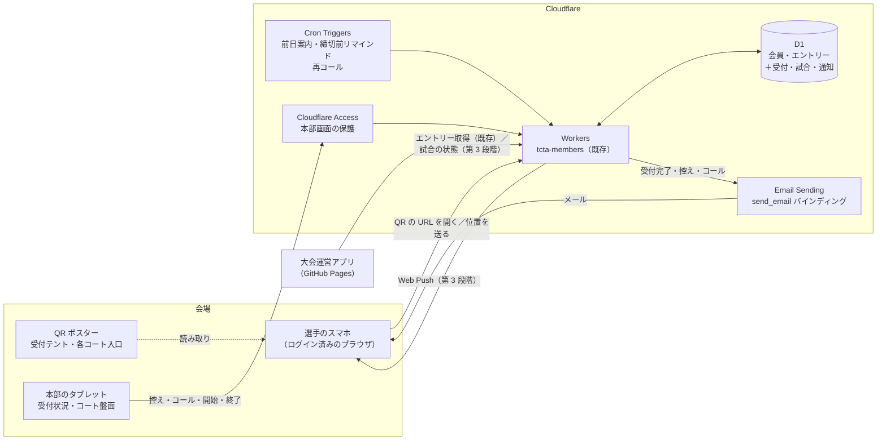
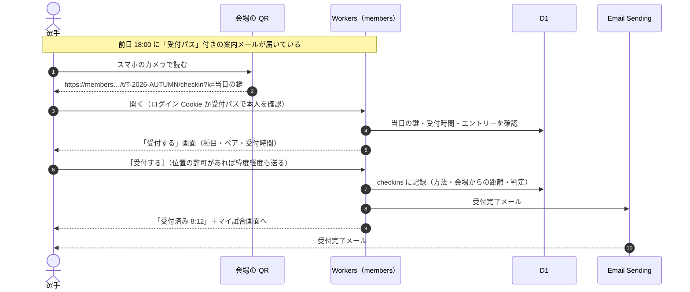
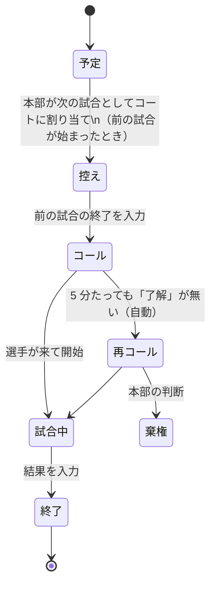

# 大会当日の受付・呼び出し通知 設計書（案 v0.1）

会員ポータル（`members/`、Cloudflare Workers ＋ D1）に、大会当日の **受付（チェックイン）** と
**控え・コールの通知** を足すための検討と設計です。運用の流れを図にした資料は
[`match-day-operations.html`](./match-day-operations.html)（役員会向け）にあります。

- 作成: 2026-10-29
- 対象: 協会に登録した会員が、自分のスマホで当日受付し、試合の呼び出しを受け取る
- 前提: 会員ポータル Phase 1（会員登録・年度登録・大会エントリー）が動いていること

---

## 1. 結論（実現できるか）

**実現できます。** 今の Cloudflare 構成（Workers・D1・Cron）に、メール送信（Email Sending）を有効にすれば足ります。
新しいサーバーやアプリストアへの公開は要りません。ただし、次の 2 点は Web の仕組み上の制約として、運用で補います。

1. **「コートに近づいただけで自動で受付」はできません。** ブラウザは、画面を開いていないときに位置情報を取れません
   （iPhone の Safari も、ホーム画面に追加した Web アプリも同じ）。自動の受付にはネイティブアプリが要り、
   開発・審査・配布の負担が協会の規模に合いません。
   代わりに **「受付ページを開いて［受付する］を押した瞬間の位置で判定」** します。選手の手間は QR を読むのと同じです。
2. **メールは数秒で届くことが多いものの、遅れることがあります**（携帯会社のメール、迷惑メールの振り分けなど）。
   コールをメールだけに頼らず、**自動で更新される「マイ試合」画面**・（第 3 段階で）**プッシュ通知**・**場内放送** を重ねます。
   システムは放送と紙の名簿を置き換えるのではなく、まずは補助として始めます。

| 機能 | 判定 | 補足 |
| --- | --- | --- |
| 会場の QR を読んで受付 | ◎ できる | 会員はログイン済みのスマホで QR を読むだけ。当日だけ有効な鍵で、写真の転送による遠隔受付を防ぐ |
| 位置情報で受付（ボタンを押したときに判定） | ○ できる | 屋外の GPS は 5〜20m の誤差。半径 200m 程度（駐車場を含む）で判定。拒否されたら QR に切り替え |
| 位置情報で自動受付（近づいただけで） | × Web ではできない | ネイティブアプリが必要。採らない |
| 受付完了メール | ◎ できる | Email Sending（Workers Paid が必要） |
| 控え・コールのメール | ○ できる | 遅れることがあるので、画面・プッシュ・放送を併用 |
| マイ試合画面（自動更新） | ◎ できる | 開いている間は 20 秒ごとに更新、コール時は画面の色と振動で知らせる |
| プッシュ通知（Web Push） | ○ できる | Android はそのまま。iPhone は iOS 16.4 以降で「ホーム画面に追加」した場合だけ |
| LINE で通知 | △ 費用次第 | 無料プランは月 200 通で、大会 1 回分にも足りない。ライトプラン（月 5,000 円・5,000 通）なら可 |

参考: Cloudflare の位置情報（`request.cf.latitude` など）は IP アドレスから推定したもので、
携帯回線では市や県の単位でしか分からないため、コートの判定には使えません。スマホの GPS（ブラウザの Geolocation API）を使います。

---

## 2. 全体構成（設計図）



- **追加の Worker は作りません。** 既存の `tcta-members` に経路を足します（会員のログイン Cookie をそのまま使えるため）。
- **本部画面** は既存の事務局画面（`/admin`、Cloudflare Access で保護）の中に置き、「大会運営」ロールの担当大会だけ操作できます（既存の権限表 `services/permissions.ts` に従う）。
- **リアルタイム性** は、選手の画面が 20 秒ごとに `GET /t/:id/me.json` を読むポーリングで足ります。
  本部の盤面を複数台で同時に動かす必要が出たら、Durable Objects ＋ WebSocket に置き換えます（第 3 段階以降の任意）。

---

## 3. 当日の流れ

### 3.1 受付（チェックイン）



本人の確認は次のどちらかです。

- **ログイン済みの Cookie**（会員ポータルのセッション、30 日）。ふだんエントリーに使っているブラウザならそのまま通ります。
- **受付パス**（前日の案内メールのリンク）。その大会・その会員・当日だけ有効な推測できない URL で、
  開くとその端末に「受付と自分の試合の確認だけ」ができる限定セッションを作ります。
  会場でマジックリンク（ログインメール）を待たずに済むようにするためです。

会場にいることの確認（どれか 1 つで受付）:

| 方法 | 仕組み | 偽装への強さ | 用途 |
| --- | --- | --- | --- |
| 掲示 QR（標準） | URL の `k` は「大会 ID ＋開催日」から作る HMAC。翌日以降は無効 | 中（QR の写真を送れば遠くでも通る） | 受付テント・各コート入口に A3 で掲示 |
| 位置情報 | ［受付する］を押したときの緯度経度と会場の距離（半径は大会ごとに設定、既定 200m） | 中（偽の GPS アプリなら通る） | QR を読めない・掲示が見えない場所 |
| 本部タブレットの QR（任意） | 30 秒ごとに変わる QR（TOTP と同じ考え方） | 高 | 不正が問題になったときだけ |
| 本部で代行 | 本部画面で氏名を検索して［受付］ | 高 | スマホを持っていない・電池切れ |

掲示 QR で受付し、位置情報も取れて会場から離れていた場合は、受付は通したうえで本部画面に「要確認」の印を付けます
（GPS の誤差で正しい受付を断らないため）。アマチュアの大会で遠隔受付をする動機は小さいので、まずは掲示 QR ＋位置の記録で始め、
問題が出たら本部タブレットの QR に切り替えます。

**受付の単位は個人** です。ダブルスは 2 人とも受付して「組として受付済み」になります。本部画面には「片方だけ」の組が分かるように出します
（ペアの片方がスマホを持っていない場合は、本部で代行するか、受付済みの相方の画面から「相方も到着」を押せるようにするかを役員会で決める）。

### 3.2 控え・コール

試合（対戦カード）とコートの割り当ては本部が持ちます。状態は次のように進みます。



| 通知 | いつ | 文面の例（件名） |
| --- | --- | --- |
| 受付完了 | 受付した直後 | 【受付完了】鳥取市秋季ダブルス大会 8:12 に受付しました |
| 締切前リマインド | 受付締切の 15 分前・未受付の人だけ | 【受付は 8:45 まで】まだ受付が済んでいません |
| 控え | 自分の試合が「控え」になったとき | 【控え】3 番コートの次の試合です。コート付近でお待ちください |
| コール | 「コール」になったとき | 【コール】3 番コートへお入りください（対戦: 山田・佐藤 組） |
| 再コール | コールから 5 分たっても「了解」が無いとき | 【再コール】3 番コートで相手がお待ちです |

メールと画面の［了解］を押すと、本部の盤面にその選手の「了解」が出ます。了解のリンクはその試合・その会員だけに効く署名付き URL です。

---

## 4. データモデル（migration `0006_match_day.sql` の案）

既存の `tournaments` / `entries` / `members` はそのまま使い、当日の運用に必要なものだけを足します。

```sql
-- 当日受付の設定（大会ごと）
ALTER TABLE tournaments ADD COLUMN checkin_open_at TEXT;        -- 受付開始（ISO, JST で入力）
ALTER TABLE tournaments ADD COLUMN checkin_close_at TEXT;       -- 受付締切
ALTER TABLE tournaments ADD COLUMN venue_lat REAL;              -- 会場の中心（コート案内 src/data/courts.js と同じ値）
ALTER TABLE tournaments ADD COLUMN venue_lng REAL;
ALTER TABLE tournaments ADD COLUMN geofence_m INTEGER NOT NULL DEFAULT 200;
ALTER TABLE tournaments ADD COLUMN checkin_modes TEXT NOT NULL DEFAULT 'qr,geo,staff';

CREATE TABLE checkins (                 -- 受付（1 エントリー × 1 会員 に 1 行）
  id TEXT PRIMARY KEY,
  tournament_id TEXT NOT NULL REFERENCES tournaments(id),
  entry_id TEXT NOT NULL REFERENCES entries(id),
  member_id TEXT NOT NULL REFERENCES members(id),
  method TEXT NOT NULL,                 -- 'qr' | 'geo' | 'rotating_qr' | 'staff'
  distance_m INTEGER,                   -- 会場の中心からの距離（座標そのものは保存しない）
  flagged INTEGER NOT NULL DEFAULT 0,   -- 1 = 範囲外などで本部の確認待ち
  by_admin TEXT,                        -- 代行したときの管理者
  at TEXT NOT NULL,
  UNIQUE(entry_id, member_id)
);

CREATE TABLE matches (                  -- 試合（対戦カード）と進行
  id TEXT PRIMARY KEY,
  tournament_id TEXT NOT NULL REFERENCES tournaments(id),
  event_code TEXT NOT NULL,
  round TEXT,                           -- '1R' | 'QF' | 'SF' | 'F' | リーグの組など
  entry_a TEXT REFERENCES entries(id),
  entry_b TEXT REFERENCES entries(id),
  court TEXT,                           -- '3'（コート番号）
  queue_no INTEGER,                     -- そのコートでの順番
  status TEXT NOT NULL DEFAULT 'scheduled', -- 'scheduled' | 'ondeck' | 'called' | 'playing' | 'done' | 'walkover'
  ondeck_at TEXT, called_at TEXT, recalled_at TEXT, started_at TEXT, finished_at TEXT,
  score TEXT,
  winner_entry TEXT REFERENCES entries(id),
  updated_by TEXT,
  updated_at TEXT NOT NULL
);
CREATE INDEX matches_court ON matches(tournament_id, court, queue_no);

CREATE TABLE match_acks (               -- 選手の「了解」
  match_id TEXT NOT NULL REFERENCES matches(id),
  member_id TEXT NOT NULL REFERENCES members(id),
  at TEXT NOT NULL,
  PRIMARY KEY (match_id, member_id)
);

CREATE TABLE notifications (            -- 送った通知（同じ通知を二重に送らない・届かなかったものを本部で見る）
  id TEXT PRIMARY KEY,
  dedupe_key TEXT NOT NULL UNIQUE,      -- 'call:<match_id>:<member_id>' など
  member_id TEXT NOT NULL REFERENCES members(id),
  tournament_id TEXT REFERENCES tournaments(id),
  kind TEXT NOT NULL,                   -- 'checkin' | 'reminder' | 'ondeck' | 'call' | 'recall'
  channel TEXT NOT NULL,                -- 'mail' | 'push'
  status TEXT NOT NULL DEFAULT 'queued',-- 'queued' | 'sent' | 'failed'
  error TEXT,
  created_at TEXT NOT NULL,
  sent_at TEXT
);

CREATE TABLE checkin_passes (           -- 前日メールの受付パス（その大会・その会員・当日だけ）
  token_hash TEXT PRIMARY KEY,
  tournament_id TEXT NOT NULL REFERENCES tournaments(id),
  member_id TEXT NOT NULL REFERENCES members(id),
  valid_on TEXT NOT NULL,               -- 開催日（JST）
  created_at TEXT NOT NULL
);

CREATE TABLE push_subscriptions (       -- 第 3 段階（Web Push）
  id TEXT PRIMARY KEY,
  member_id TEXT NOT NULL REFERENCES members(id),
  endpoint TEXT NOT NULL UNIQUE,
  p256dh TEXT NOT NULL,
  auth TEXT NOT NULL,
  created_at TEXT NOT NULL
);
```

位置情報は **距離と判定だけ** を残し、緯度経度は保存しません（既存の「最小保有」の方針、`/security` に追記する）。
`notifications` と `checkins` は大会の翌年度末に定期実行で削除します（`services/retention.ts` に足す）。

---

## 5. 画面と経路

### 選手（会員ポータル）

| 経路 | 内容 |
| --- | --- |
| `GET /t/:id/checkin?k=…` | QR の行き先。本人確認 → 受付画面（受付前・受付時間外・受付済み・エントリー無しを出し分け） |
| `POST /t/:id/checkin` | 受付。`k`（QR の鍵）または `lat`/`lng`/`accuracy`（位置）を受け取って判定 |
| `GET /p/:pass` | 受付パス。限定セッションを作って受付画面へ |
| `GET /t/:id/me` | マイ試合画面（受付状態、次の試合、コート、控え・コールの表示、［了解］） |
| `GET /t/:id/me.json` | 上の画面の自動更新用（20 秒ごと、画面が見えているときだけ） |
| `POST /m/:matchId/ack` | ［了解］（メールのリンクは署名付き URL で同じ処理） |

位置の取得は `public/members.js` に足します（既存の CSP `script-src 'self'` の範囲。外部のスクリプトは使いません）。
コールのときは画面全体を赤にして `navigator.vibrate` で知らせます（画面を開いているときだけ）。

### 本部（事務局画面 `/admin`、Cloudflare Access）

| 経路 | 内容 |
| --- | --- |
| `/admin/tournaments/:id/desk` | 受付状況。種目ごとの受付数・未受付の一覧・「要確認」・氏名検索で代行受付・紙の受付名簿（印刷用） |
| `/admin/tournaments/:id/board` | コート盤面。コートごとに「試合中／控え」を並べ、［控えにする］［コール］［開始］［終了・結果］を押す |
| `/admin/tournaments/:id/qr` | 掲示用 QR の印刷（A3）と、本部タブレット用の 30 秒ごとに変わる QR |
| `/admin/tournaments/:id/notifications` | 送った通知と、届かなかった（失敗した）通知の一覧 |

QR の画像は Worker の中で SVG として作ります（小さな QR ライブラリを同梱。外部のサービスに URL を渡さない）。

### 運営アプリとの連携（第 3 段階）

ドローと進行を大会運営アプリ（GitHub Pages）で管理している場合は、本部画面で二重入力しないように、
既存の読み取り API（`/api/v1/tournaments/:id/entries.json`）と同じトークン方式で、書き込み用の API を足します。

- `PUT /api/v1/tournaments/:id/matches` … 試合（対戦カード・コート・順番）をまとめて登録
- `POST /api/v1/tournaments/:id/matches/:matchId/status` … 状態（控え・コール・開始・終了）を更新 → 通知が出る

トークンは大会単位・期限付き・権限（読み取り／進行）を分けて発行します。

---

## 6. 通知の送り方

- 送信は既存の `lib/mail.ts`（`send_email` バインディング）を使います。本部が［コール］を押した処理の中で
  `notifications` に行を作り、`ctx.waitUntil` で送ります（押した画面は待たせない）。
- 失敗したものは `status = 'failed'` にして、毎分の定期実行で 1 回だけ再送します。本部の通知一覧で失敗が分かります。
  送る量が増えたら Cloudflare Queues（Workers Paid に含まれる）に置き換えます。
- 同じ通知は `dedupe_key` で二重に送りません（［コール］を 2 回押しても 1 通）。
- 当日だけ、定期実行を毎分にします（再コール・締切前リマインドのため）。`wrangler.jsonc` の `crons` に `* * * * *` を足し、
  開催日以外は何もせずに終わります。
- 会員ごとに「メール」「プッシュ」の受け取りを選べるようにします（マイページ）。既定はメールあり。

### 送信元ドメイン

迷惑メールに振り分けられないよう、送信元（`MAIL_FROM` = `noreply@tottori-tenis.net`）のドメインで SPF・DKIM を設定します。
Email Sending はドメインが Cloudflare の DNS にあることが前提です。**ドメインの DNS をどこで管理しているかは要確認** です。
携帯会社のメール（docomo / au / SoftBank）は、受信設定で `@tottori-tenis.net` を許可するよう前日メールと入会案内で案内します。

---

## 7. 費用と上限の見積もり

参加 150 人・試合 120 の大会を想定します（ダブルス中心で 1 試合に 4 人）。

| 項目 | 1 大会あたり | 年間（主催 19 大会） |
| --- | --- | --- |
| 前日案内・受付完了・締切前 | 約 350 通 | 約 6,700 通 |
| 控え・コール・再コール | 約 120 試合 × 4 人 × 2〜3 通 ≒ 1,100 通 | 約 21,000 通 |
| 合計 | 約 1,450 通 | 約 28,000 通（多い月で 3,000 通前後） |

| サービス | 必要なもの | 費用の目安 |
| --- | --- | --- |
| Workers Paid | **必須**（Email Sending で会員のアドレスに送るには Paid が必要） | 月 5 ドル（約 800 円）。メール月 3,000 通込み、超えた分は 1,000 通 0.35 ドル |
| Workers リクエスト | マイ試合画面の自動更新（150 人 × 20 秒ごと × 7 時間 ≒ 19 万回/日） | Paid に含まれる（無料プランの 1 日 10 万回は超える） |
| D1 | 受付・試合・通知の読み書き | 無料枠〜Paid 込みの範囲 |
| LINE（任意） | ライトプラン | 月 5,000 円（税別）・5,000 通 |

Email Sending は 2026 年 10 月時点でベータです。料金・上限は導入時に Cloudflare の料金ページで確かめてください。
ベータの間に不具合があった場合に備え、`lib/mail.ts` を差し替えれば Resend などの送信サービスにも切り替えられる作りにします。

---

## 8. セキュリティと個人情報

- 通知メールに入れるのは、大会名・種目・コート番号・時刻・対戦相手の氏名と所属だけ（ドローに載る範囲）。住所・電話は入れない。
- 受付パス・［了解］の URL は推測できないトークン（または HMAC 署名）で、大会・会員・日付に限定し、当日を過ぎたら無効。
- 本部画面の操作（代行受付・コール・結果入力）は既存の監査ログ（`audit_log`）に残す。
- 位置情報は端末の許可が必要で、拒否しても QR で受付できる。座標は保存しない。
- QR の URL を写真で共有されても、当日・その大会にエントリーした本人しか受付できない（本人確認は Cookie か受付パス）。

---

## 9. うまくいかないときの備え

| 起きること | 備え |
| --- | --- |
| 会場の電波が弱い・通信障害 | 前日に本部画面から紙の受付名簿（PDF）を印刷して持っていく。コールは放送で続ける |
| メールが遅れる・届かない | マイ試合画面と放送を併用。本部の通知一覧で失敗が分かる |
| スマホを持っていない・電池切れ | 本部で氏名検索して代行受付 |
| 位置情報の誤差で範囲外になる | 受付は通して「要確認」の印だけ付ける。半径は大会ごとに調整 |
| 本部のタブレットが止まる | 別の端末（スマホ）で同じ本部画面に入れる（Access でログイン） |

---

## 10. 進め方（段階）

| 段階 | 作るもの | 試し方 |
| --- | --- | --- |
| 1. 受付 | 掲示 QR、受付パス、受付完了メール、本部の受付状況・代行受付、締切前リマインド、紙の名簿 | 小さな大会（ふれあい大会など）で、紙の受付と並行して使う |
| 2. 呼び出し | 位置情報の受付、コート盤面、控え・コール・再コールのメール、マイ試合画面、［了解］ | 本部の進行係 1 人が盤面を操作。放送は従来どおり |
| 3. 拡張 | Web Push、運営アプリからの進行 API、30 秒ごとに変わる QR、（必要なら）LINE | 参加者の利用率と通知の遅れを見て判断 |

---

## 11. 役員会で決めること

1. Workers Paid（月 5 ドル）の契約（メール送信に必須）
2. 送信元ドメイン（`tottori-tenis.net`）を Cloudflare の DNS に置けるか（今の管理先の確認）
3. 試合の進行（コートの割り当て）を、会員ポータルの本部画面で入力するか、大会運営アプリから送るか
4. 受付の単位（個人／組）、受付時間と締切、締切までに来ない場合の扱い（棄権の判断のしかた）
5. スマホを持っていない会員の受付方法（本部で代行・相方が受付）
6. 会場（ヤマタスポーツパークなど）の携帯電波と、本部の電源・タブレットの用意
